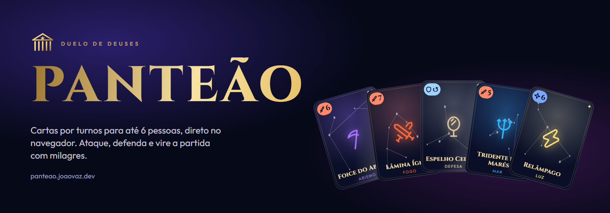
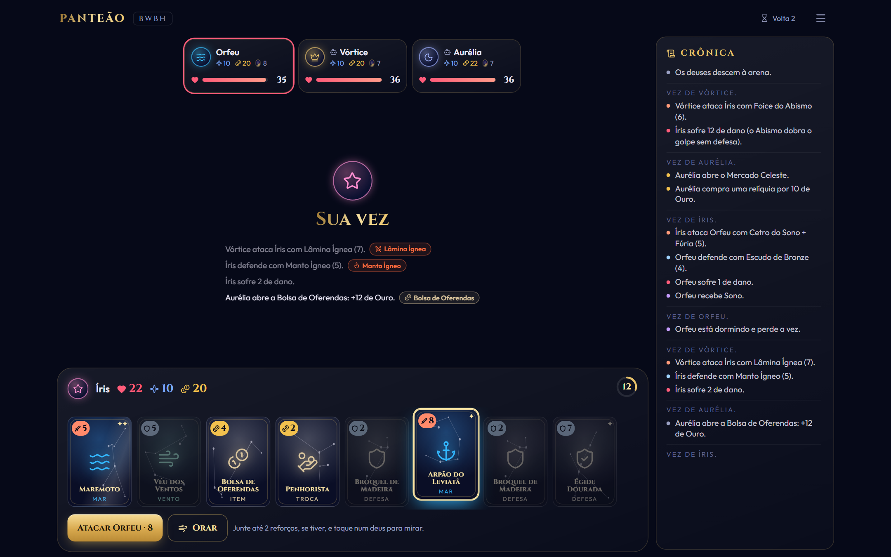
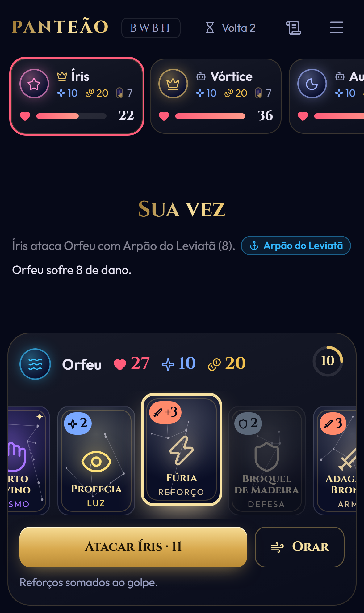
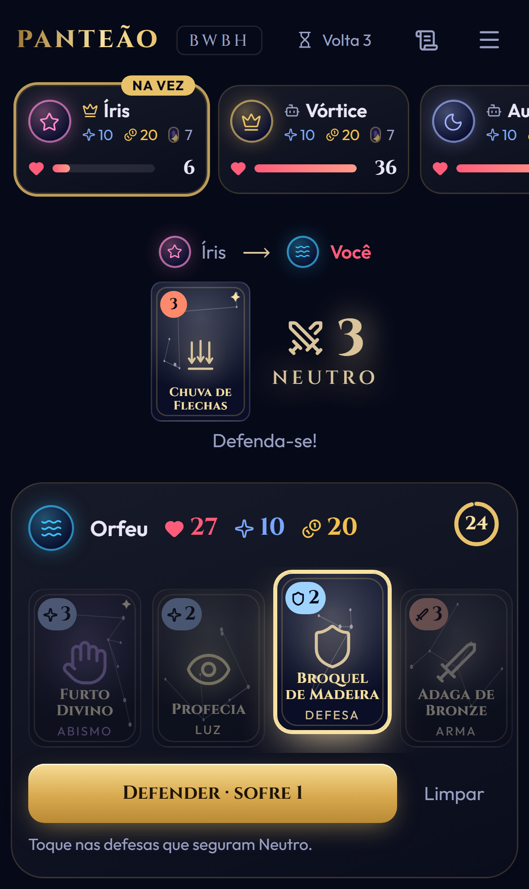
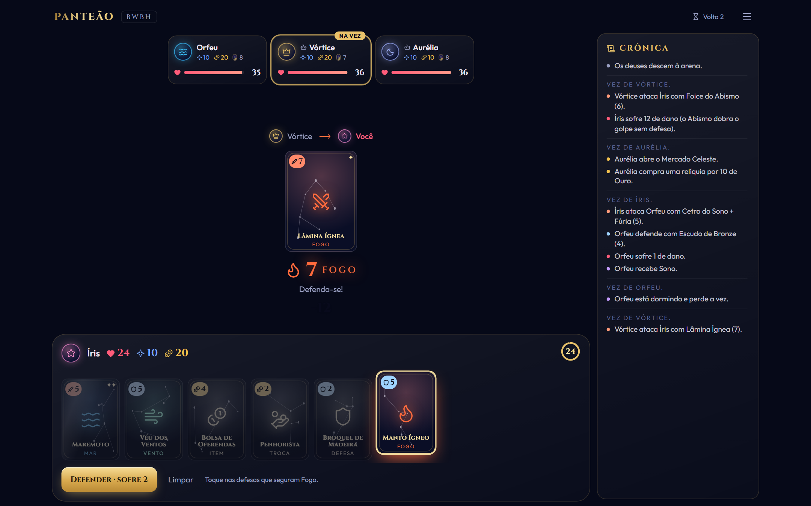
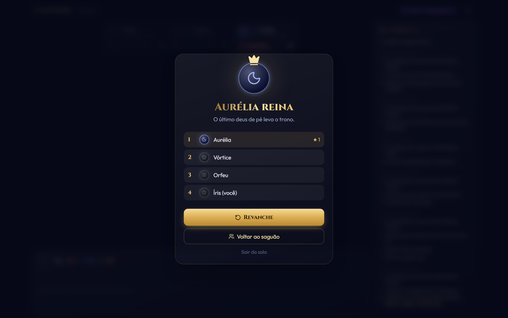
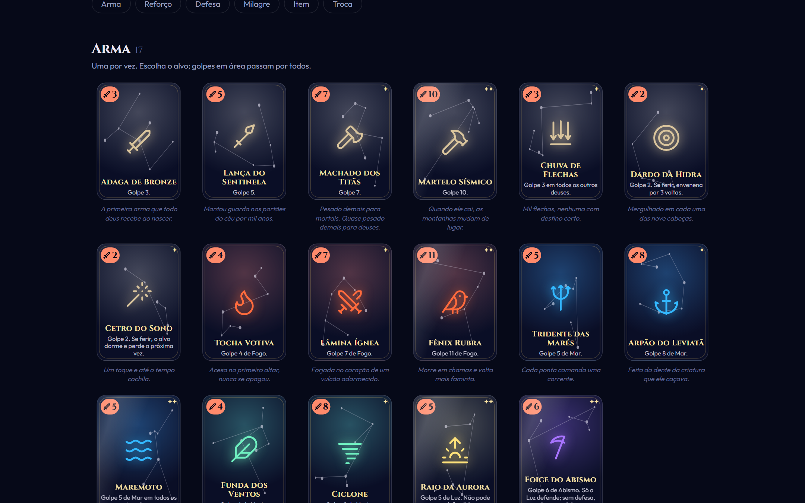
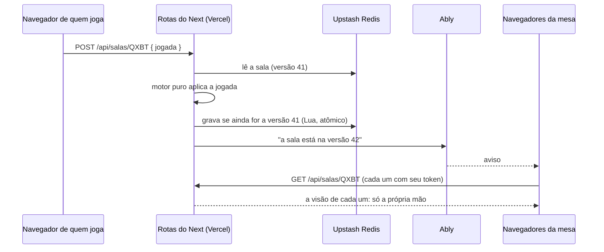

<div align="center">



<br />

[](https://panteao.joaovaz.dev)

[](https://github.com/Bleachless/panteao/actions/workflows/ci.yml)


**Um jogo de cartas por turnos para até 6 deuses, direto no navegador.**
<br />
Ataque com relíquias, defenda com o elemento certo e vire a partida com milagres.
<br />
Abre a sala, manda o link no grupo e joga, no computador ou no celular. **Sem cadastro, sem instalar nada.**

</div>

---



## 📱 No celular

<table>
  <tr>
    <td align="center"><br /><sub><b>O saguão</b><br />código, QR Code e link</sub></td>
    <td align="center"><br /><sub><b>Sua vez</b><br />arma, reforço e alvo</sub></td>
    <td align="center"><br /><sub><b>Defenda-se</b><br />só brilha o que segura o golpe</sub></td>
  </tr>
</table>

## ✨ O que ele tem

- **Multiplayer de verdade, em tempo real.** Até 6 pessoas por sala, cada uma no seu aparelho. Entrou pelo link, escolheu nome e brasão, sentou à mesa.
- **Bots para treinar.** Uma partida na hora contra 1 a 5 bots, ou bots para completar a mesa dos amigos. Eles jogam só com o que veriam: a própria mão e a mesa.
- **45 relíquias originais** em seis tipos: armas, reforços, defesas, milagres, itens e trocas. Todas no [Códice](https://panteao.joaovaz.dev/codice).
- **Seis elementos.** Escudo comum não segura Fogo, só a Luz segura o Abismo, e nada segura a Luz.
- **Espelho, esquiva, veneno, sono e silêncio.** Golpes refletidos voltam para quem atacou e podem ser defendidos de novo.
- **Mercado, penhor e alquimia.** O Ouro compra relíquias, e a Balança troca Vida por Fé (ou o contrário).
- **O Crepúsculo.** A partir da 8ª volta, todo mundo perde Vida no começo da vez, cada vez mais. Toda partida termina.
- **Relógio por jogada** (40 s, 20 s ou sem relógio). Quem some não trava a mesa: o tempo acaba e a jogada padrão entra.
- **Fechou a aba? Volta pelo mesmo link.** Um token por sala fica guardado no aparelho.
- **Revanche** com placar de vitórias da sala.







## 🃏 Regras em um minuto

Cada deus começa com **36 de Vida, 10 de Fé, 20 de Ouro e 8 cartas**. No começo da sua vez, a mão volta a ter 8 cartas. Na sua vez você faz **uma** coisa:

| Ação | Como funciona |
| --- | --- |
| ⚔️ **Atacar** | Uma arma + até 2 reforços. Escolha o alvo (armas em área pegam todos). |
| ✨ **Milagre** | Gasta Fé e **volta para a mão**: cura, relâmpago, tempestade, silêncio, furto, profecia. |
| 🧪 **Item** | Ambrosia, néctar, oferendas, ervas. Usou, acabou. |
| 🪙 **Troca** | Mercado Celeste (compra), Penhorista (vende), Balança da Alquimia (redistribui Vida, Fé e Ouro). |
| 🙏 **Orar** | Compra uma carta e passa a vez. |

Quem é atacado escolhe as defesas. **O dano é o golpe menos a soma das defesas que seguram aquele elemento:**

| Golpe | Quem segura |
| --- | --- |
| Neutro | Qualquer defesa |
| 🔥 Fogo · 🌊 Mar · 🌪️ Vento | Só a defesa do mesmo elemento |
| 🌑 Abismo | Só a Luz. Sem defesa, **dano em dobro** |
| ☀️ Luz | Ninguém |

Quem chega a 0 de Vida vira estrela. O último deus de pé reina.

## ⚡ Tempo real sem servidor próprio

Tudo roda na Vercel. Não existe um servidor de jogo ligado o tempo todo:



- **O servidor é a autoridade.** O motor do jogo roda nas rotas de API; o navegador só manda a intenção e recebe a visão dele. Ninguém vê a mão dos outros nem trapaceia pelo console.
- **O aviso não carrega segredo.** Pelo Ably passa só o número da versão; cada navegador busca a própria visão com o próprio token.
- **Compare-and-set no Redis.** Um script Lua confere a versão e grava sala e versão de uma vez. Duas jogadas ao mesmo tempo nunca se atropelam: quem perde a corrida relê e tenta de novo.
- **Bots e relógio sem cron.** Cada decisão tem um prazo salvo no estado. Quando ele vence, o navegador lê a sala, e é essa leitura que faz o servidor andar: o bot joga, ou quem estourou o tempo recebe a jogada padrão.
- **Sem conta nenhuma no computador.** Sem as variáveis do Upstash e do Ably, as salas ficam em memória e os avisos vão por Server-Sent Events. É assim que o desenvolvimento e os testes de ponta a ponta rodam.

## 🧠 Por dentro

- **Next.js 16** com Cache Components e App Router; a página do Códice e a inicial saem prontas no build, a sala é toda do cliente.
- **O jogo é feito de funções puras** (`src/game`): recebem um estado e uma jogada e devolvem o novo estado, com o "agora" vindo de fora e um gerador de números com semente dentro do estado. A mesma semente repete a mesma partida, o que deixa tudo testável.
- **A arte é código.** Cada carta tem uma constelação própria desenhada a partir do id, um ícone de traço e o brilho do seu elemento. O céu do fundo é feito só de gradientes.

```
src/
├── app/
│   ├── page.tsx               # início: criar sala, treinar ou entrar com código
│   ├── codice/                # todas as cartas e as regras
│   ├── sala/[code]/           # saguão e mesa
│   └── api/salas/             # criar, ler, jogar e os avisos por SSE; api/ably dá o token
├── game/
│   ├── cards.ts               # as 45 relíquias
│   ├── engine.ts              # turnos, golpes, defesas, mazelas, Crepúsculo, vitória
│   ├── bot.ts                 # a cabeça dos bots
│   └── room.ts                # saguão, assentos, revanche e o relógio
├── server/                    # store (memória ou Redis), avisos (SSE ou Ably) e a ponte com o jogo
├── components/                # cartas, brasões, mesa, saguão
└── lib/use-room.ts            # mantém a sala em dia no navegador
```

## 🧪 Testes

```bash
npm test
```

54 testes cobrem o motor (dano e defesa, cada elemento, Abismo em dobro, Luz indefensável, reforços que trocam o elemento, Espelho que devolve o golpe, esquiva, golpes em área na ordem da mesa, veneno, sono, silêncio, milagres que voltam para a mão, mercado, penhor, alquimia, voltas, Crepúsculo, desistência e vitória), a visão de cada jogador (nada da mão alheia vaza), o saguão e o relógio da sala. Um teste joga **150 partidas inteiras só entre bots** e confere que nenhuma jogada deles é inválida e que todas terminam.

Além disso, um roteiro de ponta a ponta com **Playwright** abre três navegadores independentes, um deles no tamanho de um celular: cria a sala, entra pelo link, vê o saguão se atualizar sozinho nas três abas, adiciona um bot, joga uma partida inteira pela interface (atacando, defendendo e orando), confere que todos veem o mesmo vencedor, chama a revanche e testa a saída no meio da partida.

O CI roda lint, checagem de tipos, testes e build a cada push.

## 🚀 Rodar localmente

```bash
git clone https://github.com/Bleachless/panteao.git
cd panteao
npm install
npm run dev
```

Abra http://localhost:3000 em duas janelas (uma anônima) para jogar contra você mesmo. Não precisa de chave nenhuma.

### No ar, na Vercel

1. Importe o repositório na Vercel.
2. Em **Storage**, adicione o **Upstash for Redis** (plano grátis). Ele cria `KV_REST_API_URL` e `KV_REST_API_TOKEN`, que o Panteão já reconhece.
3. Crie uma conta grátis no [Ably](https://ably.com), copie a API key da app e adicione `ABLY_API_KEY` nas variáveis do projeto.
4. Faça o deploy. As funções rodam em São Paulo (`gru1`).

Veja o [`.env.example`](.env.example).

## 🏛️ Inspiração

O Panteão é um projeto de portfólio inspirado nos jogos de cartas de deuses por turnos, como o [God Field](https://godfield.net). A mecânica é parecida de propósito; nome, cartas, números, textos e arte são todos originais.

---

<div align="center">

Feito por **[João Vaz](https://github.com/Bleachless)**, desenvolvedor full stack em Ribeirão Preto.
<br />
Veja também a **[Vitrola](https://github.com/Bleachless/spotify-clone)** 🎧, o **[Racha](https://github.com/Bleachless/racha-pix)** 🧾 e o **[Rende Mais](https://github.com/Bleachless/rende-mais)** 📈

</div>
